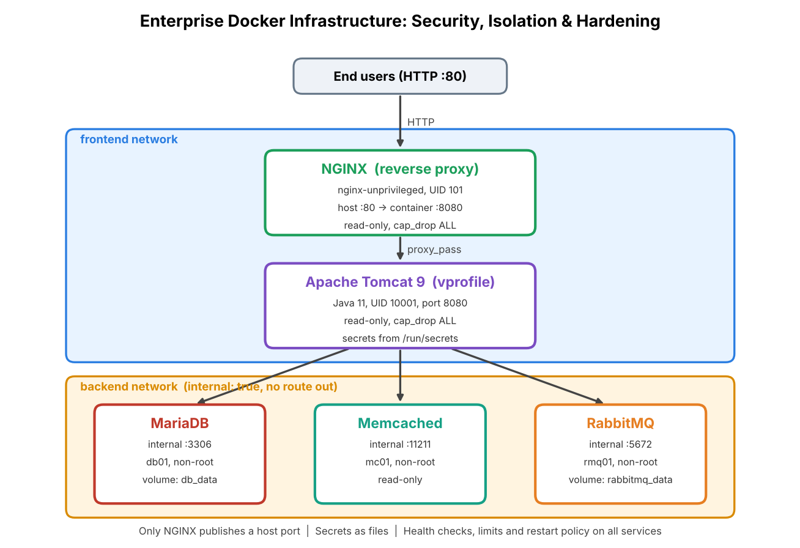

# Enterprise Docker Infrastructure: Security, Isolation & Hardening

A secure, multi-container deployment of the open-source **vprofile** Java web application using Docker Compose.
Five containers run with non-root users, dropped Linux capabilities, read-only filesystems where supported,
isolated networks, secret files, health checks, resource limits and persistent storage.

> The application source is the open-source [vprofile project](https://github.com/hkhcoder/vprofile-project)
> by **hkhcoder**, pinned to a fixed commit at build time. This repository contains the infrastructure only:
> the Compose file, Dockerfiles, NGINX and RabbitMQ configuration, helper scripts and documentation.

> **HTTP only.** TLS is outside the scope of this project. HTTP does not encrypt traffic, so deploy it in a
> trusted lab network unless you add your own protection.

## Architecture



```
 Users --HTTP:80--> NGINX (reverse proxy, non-root)
                       |  frontend network
                       v
                    Tomcat 9 / Java 11 (vprofile, non-root, port 8080)
                       |  backend network (internal: true)
          +------------+-------------+
          v            v             v
       MariaDB      Memcached     RabbitMQ
        :3306        :11211        :5672
          |                          |
       db_data                  rabbitmq_data
```

| Service | Image | Internal port | Role |
|---|---|---|---|
| nginx | `nginxinc/nginx-unprivileged:1.27-alpine` (custom) | 8080 (published as host port 80) | Reverse proxy, single entry point |
| app | multi-stage: Maven, then `tomcat:9.0-jdk11-temurin` | 8080 | Java application |
| db | `mariadb:10.11` | 3306 | Database, persistent volume |
| memcached | `memcached:1.6-alpine` | 11211 | In-memory cache |
| rabbitmq | `rabbitmq:3-alpine` | 5672 | Message broker, persistent volume |

Only NGINX publishes a host port. The `backend` network is `internal: true`, so the database, cache and broker
cannot be reached from outside and have no route to the internet.

## Security Hardening

| Control | Implementation |
|---|---|
| Non-root execution | `user:` on every service (Tomcat UID 10001, NGINX UID 101, others use their image's own user) |
| Capabilities | `cap_drop: [ALL]` on every service |
| No privilege escalation | `no-new-privileges:true` on every service |
| Read-only filesystem | NGINX, Tomcat and Memcached, with `tmpfs` for temporary paths |
| Network isolation | Separate `frontend` and `backend` networks, backend is internal |
| Secrets | Docker secret files in `secrets/` (git-ignored), never in images, `.env` or Git |
| Least privilege database access | The application uses a dedicated user, not root |
| Resource limits | `mem_limit` and `cpus` on every service |
| Restart policy | `restart: unless-stopped` |
| Health checks | All five services, with `depends_on: condition: service_healthy` |

Details and verification commands are in [`docs/security.md`](docs/security.md).

## Project Structure

```
enterprise-docker-infrastructure/
├── docker-compose.yml
├── .env.example               # non-sensitive settings (usernames)
├── .gitignore
├── LICENSE
├── README.md
├── app/
│   ├── Dockerfile             # Maven build, then non-root Tomcat
│   └── entrypoint.sh          # loads secrets, starts Tomcat
├── nginx/
│   ├── Dockerfile
│   └── nginx.conf
├── db/
│   └── db_backup.sql          # sample data, loaded on first start only
├── rabbitmq/
│   └── rabbitmq.conf
├── secrets/
│   └── .gitkeep               # real secret files are generated locally
├── scripts/
│   ├── deploy.sh
│   ├── validate.sh
│   └── backup.sh
└── docs/
    ├── architecture.png
    ├── security.md
    └── troubleshooting.md
```

## Prerequisites

- Linux VM or server with Docker Engine and the Docker Compose plugin
  (`docker --version`, `docker compose version`)
- Internet access for the first build (images and Maven dependencies)
- About 3 GB of free RAM for the five containers

## Deployment

```bash
git clone https://github.com/EmadGirgisSamaan/enterprise-docker-infrastructure.git
cd enterprise-docker-infrastructure
./scripts/deploy.sh
```

`deploy.sh` generates random passwords into `secrets/`, creates `.env` from `.env.example`,
builds the images, starts the stack and waits until every service is healthy.

Manual equivalent:

```bash
mkdir -p secrets
for f in db_password db_root_password rabbitmq_password; do
  openssl rand -base64 24 | tr -d '\n=+/' > secrets/$f.txt; chmod 600 secrets/$f.txt
done
cp .env.example .env
docker compose up -d --build
docker compose ps
```

The first build takes several minutes while Maven downloads dependencies.
Then open `http://localhost`, or `http://<server-ip>` from another machine.

## Validation

```bash
./scripts/validate.sh          # read-only checks
./scripts/validate.sh --full   # also tests persistence and restart recovery
```

| ID | Requirement | Check |
|---|---|---|
| AC-01 | Container deployment | `docker compose ps` lists five running services |
| AC-02 | Application access | `curl -L http://localhost` returns HTTP 200 |
| AC-03 | Reverse proxy | Pages are served through NGINX only |
| AC-04 | Database connectivity | `app` reaches `db01:3306`, and the application user can query `accounts` |
| AC-05 | Cache connectivity | `app` reaches `mc01:11211` |
| AC-06 | Messaging connectivity | `app` reaches `rmq01:5672` |
| AC-07 | Non-root execution | `docker compose exec <service> id -u` is not 0 |
| AC-08 | Container hardening | `cap_drop`, `no-new-privileges` and `read_only` confirmed with `docker inspect` |
| AC-09 | Health checks | All five services report `healthy` |
| AC-10 | Network isolation | Only NGINX publishes a host port, backend network is internal |
| AC-11 | Persistent storage | `--full` recreates containers and compares database row counts |
| AC-12 | Resource management | Memory and CPU limits are present on every container |
| AC-13 | Restart policies | `--full` kills Tomcat and confirms it comes back |
| AC-14 | Secrets management | No credentials in images or Git, `secrets/` is ignored |
| AC-15 | Documentation | This README, `docs/security.md`, `docs/troubleshooting.md` |

Add your own screenshots or terminal output of a passing run under `docs/` as evidence.

## Operations

| Task | Command |
|---|---|
| Status and health | `docker compose ps` |
| Follow application logs | `docker compose logs -f app` |
| Resource usage | `docker stats --no-stream` |
| Rebuild only Tomcat | `docker compose up -d --build app` |
| Stop (data is kept) | `docker compose down` |
| Stop and delete all data | `docker compose down -v` |
| Backup | `./scripts/backup.sh` |

### Backup and recovery

`scripts/backup.sh` writes a compressed MariaDB dump and an archive of the RabbitMQ volume to `backups/`
(git-ignored) and keeps the seven most recent copies of each.

Restore the database:

```bash
gunzip -c backups/accounts_<timestamp>.sql.gz | \
  docker compose exec -T db sh -c 'mariadb -uroot -p"$(cat /run/secrets/db_root_password)" accounts'
```

Test restores regularly. A backup that was never restored is not a verified backup.

### Recovery behaviour

- `restart: unless-stopped` restarts a container when its main process exits and after a Docker daemon restart.
- It does **not** restart a container only because its health check reports `unhealthy`.
- `depends_on` controls startup order only. vprofile has no connection retry logic, so if MariaDB or RabbitMQ
  restarts while Tomcat is running, run `docker compose restart app`.

## Notes on the vprofile application

- The application has no `/health` endpoint, so the Tomcat health check requests `/login`.
- Its `application.properties` has hardcoded credentials. The Tomcat build stage replaces them with
  placeholders, and `entrypoint.sh` fills them from the secret files at runtime.
- The hostnames `db01`, `mc01` and `rmq01` are provided as network aliases so the application finds its
  dependencies without code changes.
- The demo application ships with a sample admin account (`admin_vp`). Use it for lab testing only.

## Troubleshooting

See [`docs/troubleshooting.md`](docs/troubleshooting.md).

## Credits

- Application: [hkhcoder/vprofile-project](https://github.com/hkhcoder/vprofile-project)
- Infrastructure (Compose, Dockerfiles, configuration, scripts, documentation): Emad Girgis Samaan

## License

The infrastructure files are released under the MIT License (see `LICENSE`).
The vprofile application keeps its own license from its original author.

## Author

**Emad Girgis Samaan**: IT Manager with 25+ years in infrastructure and networking, moving into DevOps.
Open to remote DevOps roles in Europe.
